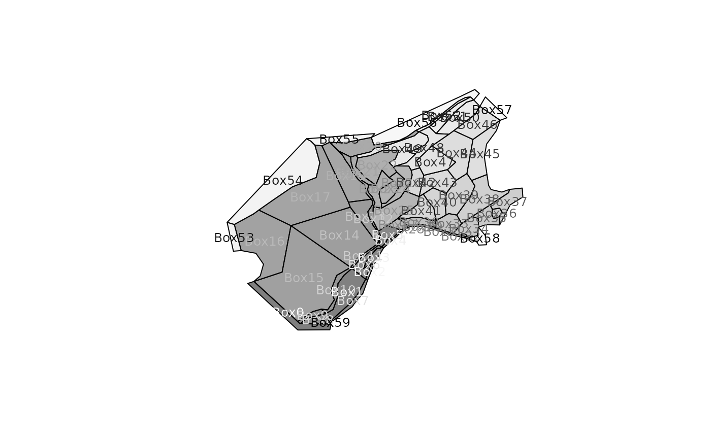
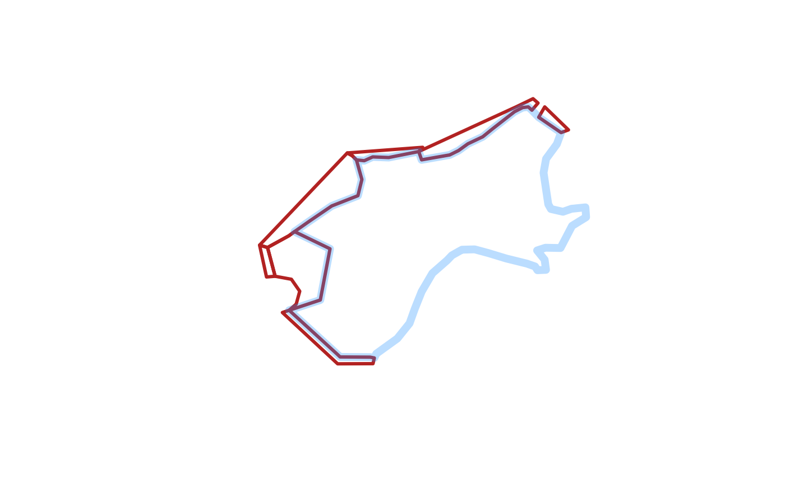
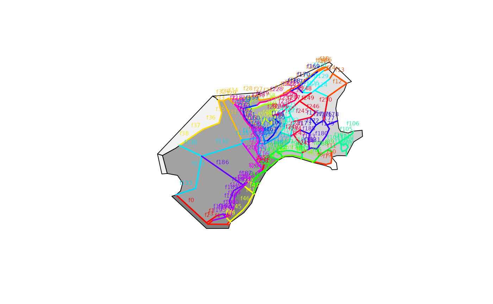
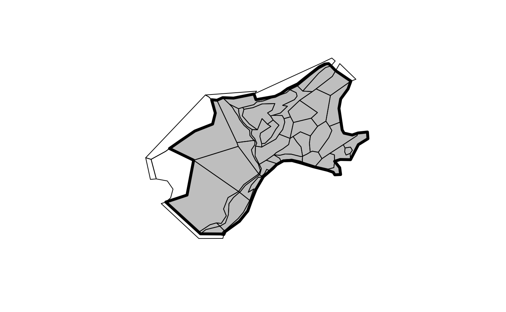

# BGM as Spatial objects

Read in an example .bgm file with `bgmfile`, and plot it as
box-polygons.

``` r

library(rbgm)
library(bgmfiles) ## example files
## example data set in package
fname <- bgmfiles(pattern = "Nordic")[1L]
bgm <- bgmfile(fname)
plot(boxSpatial(bgm), col = grey(seq(0, 1, length = nrow(bgm$boxes))))
```


The function `bgmfile` returns a generic list structure of tables, which
currently includes the following. More on these later.

``` r

print(names(bgm))
#> [1] "vertices"         "facesXverts"      "faces"            "facesXboxes"     
#> [5] "boxesXverts"      "boxes"            "boundaryvertices" "extra"
```

There are functions for converting from the raw .bgm data structures to
`Spatial` objects, as defined in the `sp` package. (Spatial objects are
formal GIS-like data that store a table of attribute data against a set
of matching polygons, lines or points.)

- `boxSpatial` converts to a `SpatialPolygonsDataFrame`, with a table of
  attributes relevant to the boxes
- `faceSpatial` converts to a `SpatialLinesDataFrame`, with attributes
  for the faces (straight line edges that define box boundaries)
- `nodeSpatial` converts to a \`SpatialPointsDataFrame, with attributes
  for the unique vertices in the model
- `pointSpatial` converts to a `SpatialPointsDataFrame`, with attributes
  for all instances of the vertices in the model (faces share vertices)
- `boundarySpatial` converts just the boundary path to
  `SpatialPolygonsDataFrame`

From these conversions we can export to GIS formats such as
[GeoPackage](https://www.geopackage.org/).

It’s important to note that the Spatial objects cannot store the full
topological and attribute information present in the .bgm, so these are
convenience converters that are one-way. We can generate .bgm from these
objects, but it cannot be stored in just one Spatial object.

These converter functions provide fully-functional objects with complete
coordinate system metadata, that we can subset, interrogate and plot.

``` r

(spdf <- boxSpatial(bgm))
#> class       : SpatialPolygonsDataFrame 
#> features    : 60 
#> extent      : -1411988, 1849768, 3463169, 6117110  (xmin, xmax, ymin, ymax)
#> crs         : +proj=aea +lat_1=43 +lat_2=62 +lat_0=30 +lon_0=10 +x_0=0 +y_0=0 +ellps=intl +units=m +no_defs 
#> variables   : 11
#> names       : label, nconn,  botz,             area, vertmix, horizmix,           insideX,          insideY, .bx0, boundary, box_id 
#> min values  :  Box0,     0, -3255,  1317077441.6413,   1e-04,        1, -1334344.11869758, 3543086.16022841,    0,        0,      0 
#> max values  :  Box9,    21,     0, 525138111862.757,   0.001,        2,   1668909.2842076,  5889207.4351272,   59,        1,     59

(sldf <- faceSpatial(bgm))
#> class       : SpatialLinesDataFrame 
#> features    : 253 
#> extent      : -1116549, 1703682, 3521699, 6035115  (xmin, xmax, ymin, ymax)
#> crs         : +proj=aea +lat_1=43 +lat_2=62 +lat_0=30 +lon_0=10 +x_0=0 +y_0=0 +ellps=intl +units=m +no_defs 
#> variables   : 7
#> names       :             cosine,              sine, left, right,           length, .fx0,  label 
#> min values  : -0.996668837654093, -0.99648270316708,    0,     1, 711.256615760743,    0,  face0 
#> max values  :  0.999976969046993, 0.999666398127426,   59,    59, 803970.852887957,  252, face99
```

Subset based on attribute

``` r

subset(spdf, horizmix == 0, select = label)
#> class       : SpatialPolygonsDataFrame 
#> features    : 0 
#> crs         : +proj=aea +lat_1=43 +lat_2=62 +lat_0=30 +lon_0=10 +x_0=0 +y_0=0 +ellps=intl +units=m +no_defs 
#> variables   : 1
#> names       : label

plot(boxSpatial(bgm), col = grey(seq(0, 1, length = nrow(bgm$boxes)), alpha = 0.5))

text(coordinates(spdf), labels = spdf$label, col = grey(seq(1, 0, length = nrow(bgm$boxes))), cex = 0.8)
```



For illustration isolate boxes that are outside the boundary.

``` r

## subset the boundary boxes
plot(subset(spdf, boundary), border = "firebrick", lwd = 3)

## or just get a single boundary for the inner
plot(boundarySpatial(bgm), border =  "#1E90FF4C", lwd = 7, add = TRUE)
```



Plot the boxes and then label the faces.

``` r

plot(boxSpatial(bgm), col = grey(seq(0, 1, length = nrow(bgm$boxes)), alpha = 0.5))


plot(sldf, col = rainbow(nrow(sldf)), lwd = 2,  add = TRUE)
text(do.call(rbind, lapply(coordinates(sldf), function(x) apply(x[[1]], 2, mean))), 
     labels = gsub("ace", "", sldf$label), cex = 0.5, col = rainbow(nrow(sldf)), pos = 3)
```



Obtain the boundary polygon and plot.

``` r

plot(boundarySpatial(bgm), lwd = 4, col = "grey")
plot(boxSpatial(bgm), add = TRUE)
```



## More information

The BGM format and usage is described at the Atlantis site.
<https://research.csiro.au/atlantis/>
