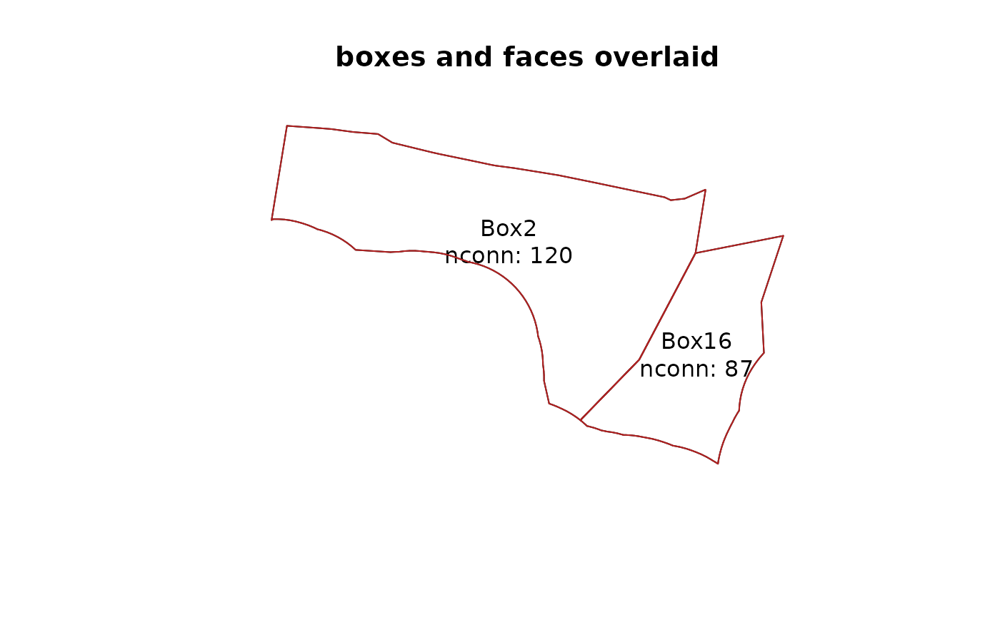

# Box Geometry Model (BGM) files

## Box Geometry Model files

Box Geometry Model files are text files that store a spatially-explicit
model domain used by the Atlantis Ecosystem Model.

The model domain consists of **boxes** (polygons) composed of **faces**
(line segments) and an overall **boundary** that delimits the domain of
the model.

The boundary will include boundary polygons that are not boxes in the
model, but some box edges are on this boundary, for example some models
bounded by land do not have boundary boxes on this edge.

The **rbgm** package includes tools to read the BGM format, returning
tables of all X/Y vertices and tables of indices for the boxes and
faces.

``` r

library(rbgm)
library(dplyr)
mfile <- bgmfiles::bgmfiles()[1]

bgm <- bgmfile(mfile)

names(bgm)
```

    ## [1] "vertices"         "facesXverts"      "faces"            "facesXboxes"     
    ## [5] "boxesXverts"      "boxes"            "boundaryvertices" "extra"

## Box and face attributes, and model topology

Both boxes and faces have attributes stored row-wise in the respective
table.

These are the box attributes for this example

``` r

print(bgm$boxes)
```

    ## # A tibble: 35 × 9
    ##    label nconn  botz        area vertmix horizmix  insideX  insideY  .bx0
    ##    <chr> <int> <dbl>       <dbl>   <int>    <int>    <dbl>    <dbl> <dbl>
    ##  1 Box0      7 -53.7 9254788445.       1        1 3430169. 3073000.     0
    ##  2 Box1     81 -48.9 1996056923.       1        1 3498567. 3029308.     1
    ##  3 Box2    120 -55.7 3922348664.       1        1 3521055. 3050400.     2
    ##  4 Box3    105 -53.4 3576072582.       1        1 3523085. 3077300.     3
    ##  5 Box4     83 -30   1672921591.       1        1 3522699. 3102469.     4
    ##  6 Box5     12 -24.1  411048577.       1        1 3496968. 3124359.     5
    ##  7 Box6     16 -10.2  447377917.       1        1 3520947. 3133926.     6
    ##  8 Box7     18   0    402661184.       1        1 3523883. 3122610.     7
    ##  9 Box8     13 -15    705100219.       1        1 3562646. 3115917.     8
    ## 10 Box9      3  -5.4   93312196.       1        1 3581060. 3127380.     9
    ## # ℹ 25 more rows

and these are the face attributes.

``` r

print(bgm$faces)
```

    ## # A tibble: 824 × 7
    ##    cosine  sine  left right length  .fx0 label
    ##     <dbl> <dbl> <int> <int>  <dbl> <dbl> <chr>
    ##  1  0.112 0.994    34    32 29876.     0 face0
    ##  2  0.506 0.862    32    33 17891.     1 face1
    ##  3  0.116 0.993    34    33 10169.     2 face2
    ##  4  0.117 0.993    34    33   155.     3 face3
    ##  5  0.869 0.494    33    27  9391.     4 face4
    ##  6  0.118 0.993    34    27 12818.     5 face5
    ##  7  0.121 0.993    34    27 21316.     6 face6
    ##  8  0.276 0.961    32    33 25394.     7 face7
    ##  9  0.514 0.858    32    33  8425.     8 face8
    ## 10  0.136 0.991    32    30 14366.     9 face9
    ## # ℹ 814 more rows

By using relations between these tables we can reconstruct the geometry
appropriately. (This is pretty painful, but shows that we have all the
information required.)

``` r

bgm$boxes %>% 
  filter(label %in% c("Box1", "Box11"))  %>% 
  inner_join(bgm$boxesXverts, ".bx0") %>% 
  head()
```

    ## # A tibble: 6 × 10
    ##   label nconn  botz        area vertmix horizmix  insideX  insideY  .bx0  .vx0
    ##   <chr> <int> <dbl>       <dbl>   <int>    <int>    <dbl>    <dbl> <dbl> <int>
    ## 1 Box1     81 -48.9 1996056923.       1        1 3498567. 3029308.     1   157
    ## 2 Box1     81 -48.9 1996056923.       1        1 3498567. 3029308.     1   178
    ## 3 Box1     81 -48.9 1996056923.       1        1 3498567. 3029308.     1   222
    ## 4 Box1     81 -48.9 1996056923.       1        1 3498567. 3029308.     1   219
    ## 5 Box1     81 -48.9 1996056923.       1        1 3498567. 3029308.     1   218
    ## 6 Box1     81 -48.9 1996056923.       1        1 3498567. 3029308.     1   217

## Convert to Spatial objects

To avoid constructing boxes and faces manually, `rbgm` provides several
helper functions to create the boxes, faces, coordinates, and boundary
as `Spatial` objects from the `sp` package.

Since Spatial objects cannot store the full connectivity of the BGM
structure, it is best to consider these as one-way conversions, keeping
all the details in the raw tables as above.

To generate an object with just “Box1” and “Box11”, use the function
`boxSpatial` and then subset on box labels.

``` r

boxes <- subset(boxSpatial(bgm), label %in% c("Box2", "Box16"))
```

To determine which faces belong to these boxes, first create all faces
and then join.

``` r

allfaces <- faceSpatial(bgm)
faces <- allfaces[match(bgm$facesXboxes$iface[which(bgm$facesXboxes$.bx0 %in% boxes$.bx0)], allfaces$.fx0), ]
```

Plot the two layers together.

``` r

plot(boxes, main = "boxes only")
text(coordinates(boxes), lab = sprintf("%s\nnconn: %s", boxes$label, boxes$nconn))
```


``` r

plot(boxes, main = "boxes and faces overlaid")
text(coordinates(boxes), lab = sprintf("%s\nnconn: %s", boxes$label, boxes$nconn))
plot(faces, col = c("firebrick"), lwd = 1, add = TRUE)
```



(Future releases will provide simpler tools to do this kind of
matching).
